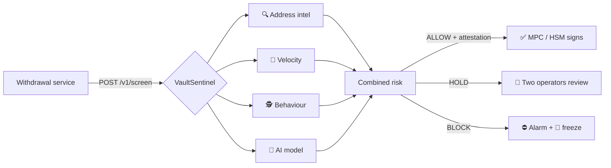
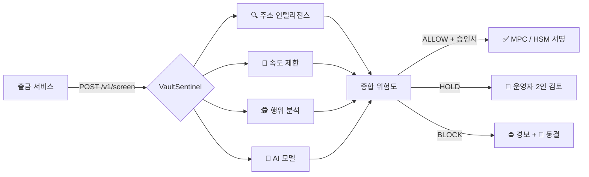

<div align="center">

# 🛡️ VaultSentinel

### AI-powered pre-signing firewall for crypto exchange hot wallets
### 암호화폐 거래소 핫월렛을 위한 AI 서명 전 방화벽

[](.github/workflows/ci.yml)
[](https://www.python.org/)
[](https://fastapi.tiangolo.com/)
[](sentinel/detectors/anomaly.py)
[](sentinel/attestation.py)
[](sentinel/providers)
[](Dockerfile)
[](LICENSE)

**[🇺🇸 English](#english)** · **[🇰🇷 한국어](#korean)**

</div>

---

<a name="english"></a>

## 🇺🇸 English

### ⚡ Why

On **29 October 2026**, according to on-chain analysts, between **$2.5B and $5.6B** left Binance hot wallets in about 40 minutes.
A single transaction carried ~167,000 ETH and **63 tokens at once** to an address that did not exist that morning,
a second hot wallet paid the **same** address 24 seconds later, and the gas for the attack came through **Tornado Cash**.
*(Binance had not confirmed a hack at the time of writing — [full case study](docs/INCIDENT-2026-10-29.md).)*

Every one of those hallmarks can be caught automatically. **VaultSentinel sits right before the signature** and
stops the outflow at the first transaction, then freezes every hot wallet.

> Inspired by the South Korean approach, where the law requires exchanges to keep **at least 80% of customer
> assets in cold storage** and keep hot wallets tightly limited.

### ✨ Features

| | Module | What it does |
|---|---|---|
| 🧠 | **AI anomaly detection** | Isolation Forest trained on your own withdrawal history + an online per-wallet baseline |
| 🔍 | **Address intelligence** | Blocks fresh addresses, mixer-funded addresses, denylisted and sanctioned destinations |
| 🚦 | **Velocity limits** | Per-tx and per-asset caps, share-of-wallet cap, sliding windows per wallet and exchange-wide |
| 🕵️ | **Behavioural rules** | Unknown initiators, several wallets paying one address, first payouts, off-hours |
| 🧨 | **Circuit breaker** | Freezes a wallet, or **all** wallets during a multi-wallet attack; unfreeze needs two operators |
| ✍️ | **Signed attestations** | Every ALLOW is Ed25519-signed and bound to the exact tx; signers refuse anything else |
| 👥 | **Four-eyes review** | HOLD queue with multi-operator approval in a web console |
| 📜 | **Tamper-evident audit** | SHA-256 hash-chained log of every decision |
| 📣 | **Alerts** | Telegram, Slack, signed webhooks + ready-to-send USDT / USDC freeze requests |
| 🏦 | **Treasury monitor** | Hot / cold ratio check against the 80% rule |
| 📊 | **Observability** | Prometheus metrics and alert rules |
| 🔒 | **Fail-closed** | Missing data or errors raise risk, never lower it |

### 🏗️ How it works



`risk = 1 − Π(1 − scoreᵢ)` · any hard rule → **BLOCK** · details in [ARCHITECTURE.md](docs/ARCHITECTURE.md)

### 🎬 Replay of 29 Oct 2026

```console
$ sentinel replay-incident
[BLOCK] replay-1  $   1,988,000,000  0xbinance14 -> 0xattacker0000…  risk=1.00
          · [address_intel] Destination has no on-chain history (fresh address)
          · [velocity] Single tx $1,988,000,000 exceeds cap $2,000,000
          · [velocity] 64 assets in one tx (wallet sweep pattern)
          · [velocity] Tx drains 95% of the hot wallet balance
          · [behavior] Initiator 'unknown-signer' is not a trusted withdrawal service
[BLOCK] replay-2  $      65,000,000  0xbinance16 -> 0xattacker0000…  risk=1.00  🧨 BREAKER
          · [behavior] 2 hot wallets paying the same destination within 600s
[BLOCK] replay-3  ...  Wallet is frozen by the circuit breaker
```

*Illustrative output; exact lines depend on your policy.*

### 🚀 Quick start

```bash
git clone https://github.com/webphilo/vault-sentinel.git
cd vault-sentinel
cp .env.example .env
sentinel keygen >> .env          # or: make keygen
docker compose up -d --build     # Sentinel + Redis + Prometheus
```

Console: `http://localhost:8080/` · API docs: `http://localhost:8080/docs`

<details>
<summary>Without Docker</summary>

```bash
python -m venv .venv && source .venv/bin/activate   # Windows: .venv\Scripts\activate
pip install -e ".[redis]"
make train          # synthetic history + model (replace with your real export)
make run            # dev mode, no external calls
```
</details>

### 📡 API

```bash
curl -X POST http://localhost:8080/v1/screen \
  -H "X-API-Key: $SENTINEL_API_KEY" -H "Content-Type: application/json" \
  -d '{"request": {"request_id": "wd-1", "chain": "ethereum", "asset": "USDT",
       "amount": 2500, "amount_usd": 2500, "source_wallet": "0xHot1",
       "destination": "0xUser", "initiator": "withdrawal-service"},
       "wallet_balance_usd": 40000000}'
```

| Method | Path | Who | Purpose |
|---|---|---|---|
| `POST` | `/v1/screen` | service | Screen a withdrawal before signing |
| `GET` | `/v1/public-key` | public | Attestation public key |
| `POST` | `/v1/treasury` | service | Report hot / cold balances |
| `GET` | `/v1/holds` | operator | Withdrawals awaiting review |
| `POST` | `/v1/holds/{id}/approve` · `/reject` | operator | Review a held withdrawal |
| `GET` | `/v1/breaker` | any | Frozen wallets |
| `POST` | `/v1/breaker/trip` | any | Freeze a wallet (or `__all__`) |
| `POST` | `/v1/breaker/reset` | operator | Vote to unfreeze |
| `POST` | `/v1/freeze-draft` | operator | Stablecoin freeze-request draft |
| `GET` | `/v1/audit` · `/v1/audit/verify` | operator | Audit log and integrity check |
| `GET` | `/v1/stats` | operator | Decision counts |
| `GET` | `/metrics` · `/health` · `/ready` | infra | Monitoring |

### 🧰 CLI

```text
sentinel serve              run the API
sentinel keygen             create an Ed25519 key pair
sentinel gen-data FILE      synthetic withdrawal history
sentinel train FILE         train the AI model
sentinel replay-incident    replay the 29 Oct 2026 outflow
sentinel verify-audit       check the audit hash chain
```

### 📁 Project layout

```
vault-sentinel/
├── sentinel/
│   ├── api.py               REST API + console
│   ├── engine.py            decision engine
│   ├── detectors/           🔍 address · 🚦 velocity · 🕵️ behaviour · 🧠 AI
│   ├── providers/           EVM · Tron · Solana · Bitcoin
│   ├── alerts/              Telegram · Slack · webhooks · freeze drafts
│   ├── attestation.py       ✍️ Ed25519 approvals
│   ├── breaker.py           🧨 circuit breaker
│   ├── holds.py             👥 review queue
│   ├── audit.py             📜 hash-chained log
│   ├── state.py             memory / Redis
│   ├── treasury.py          🏦 cold-storage ratio
│   ├── client.py            Python SDK for signers
│   └── dashboard/           operator console
├── config/                  policy.yaml + address lists
├── deploy/                  Kubernetes · Prometheus
├── docs/                    architecture · integration · threat model · case study
├── examples/                signer integration
└── tests/
```

### 🗺️ Roadmap

- [x] Rules, velocity limits, behavioural detection, AI anomaly model
- [x] Signed attestations, circuit breaker, four-eyes review, hash-chained audit
- [x] EVM, Tron, Solana, Bitcoin providers
- [ ] Chainalysis / TRM / Arkham label feeds
- [ ] Graph clustering of attacker addresses
- [ ] Native co-signer plug-ins for popular MPC stacks
- [ ] XRP, TON, Cosmos providers

### ⚠️ Limitations

VaultSentinel protects the **signing path**. If a private key is exfiltrated and used outside the pipeline,
no pre-signing filter can see it — make VaultSentinel a mandatory MPC / multisig co-signer
([INTEGRATION.md](docs/INTEGRATION.md), [THREAT_MODEL.md](docs/THREAT_MODEL.md)).
Thresholds must be tuned to your volumes, and a security audit is required before production use.

---

<a name="korean"></a>

## 🇰🇷 한국어

### ⚡ 왜 필요한가

온체인 분석가들의 추정에 따르면 **2026년 10월 29일**, 약 40분 동안 바이낸스 핫월렛에서 **25억~56억 달러**가 빠져나갔습니다.
단 한 건의 트랜잭션으로 약 167,000 ETH와 **63종의 토큰**이 그날 아침까지 존재하지 않던 주소로 이동했고,
24초 뒤 다른 핫월렛이 **같은 주소**로 송금했으며, 공격에 쓰인 가스비는 **Tornado Cash**를 통해 조달되었습니다.
*(작성 시점 기준 바이낸스는 해킹을 공식 확인하지 않았습니다 — [상세 분석](docs/INCIDENT-2026-10-29.md).)*

이 징후들은 모두 자동으로 탐지할 수 있습니다. **VaultSentinel은 서명 직전 단계에 위치하여**
첫 번째 트랜잭션에서 유출을 차단하고 모든 핫월렛을 즉시 동결합니다.

> 고객 자산의 **80% 이상을 콜드월렛에 보관**하도록 법으로 의무화하고 핫월렛을 엄격히 제한하는
> 한국 시장의 접근 방식에서 영감을 받았습니다.

### ✨ 주요 기능

| | 모듈 | 설명 |
|---|---|---|
| 🧠 | **AI 이상 탐지** | 거래소 자체 출금 이력으로 학습한 Isolation Forest + 지갑별 실시간 기준선 |
| 🔍 | **주소 인텔리전스** | 신규 주소, 믹서로 충전된 주소, 차단·제재 대상 주소 차단 |
| 🚦 | **출금 속도 제한** | 건당·자산별 한도, 지갑 잔액 대비 비율, 지갑별·거래소 전체 슬라이딩 윈도우 |
| 🕵️ | **행위 기반 규칙** | 미등록 요청자, 여러 지갑에서 한 주소로의 송금, 최초 송금, 비근무 시간 |
| 🧨 | **서킷 브레이커** | 단일 지갑 또는 다중 지갑 공격 시 **전체** 지갑 동결, 해제는 운영자 2인 승인 |
| ✍️ | **서명된 승인서** | 모든 ALLOW는 Ed25519로 서명되어 해당 트랜잭션에만 유효, 서명자는 그 외 거부 |
| 👥 | **4-eyes 검토** | 웹 콘솔에서 다수 운영자 승인이 필요한 HOLD 대기열 |
| 📜 | **위변조 방지 감사 로그** | 모든 결정을 SHA-256 해시 체인으로 기록 |
| 📣 | **알림** | Telegram, Slack, 서명된 웹훅 + USDT/USDC 동결 요청서 자동 작성 |
| 🏦 | **자산 보관 모니터** | 80% 콜드월렛 규정 준수 여부 점검 |
| 📊 | **모니터링** | Prometheus 메트릭 및 경보 규칙 |
| 🔒 | **Fail-closed** | 데이터 누락이나 오류 시 위험도를 낮추지 않고 높임 |

### 🏗️ 동작 방식



`risk = 1 − Π(1 − scoreᵢ)` · 강제 규칙 하나라도 해당 시 **BLOCK** · 자세한 내용은 [ARCHITECTURE.md](docs/ARCHITECTURE.md)

### 🎬 10월 29일 사건 재현

```bash
sentinel replay-incident
```

첫 번째 트랜잭션은 신규 주소, 건당 한도 초과, 63종 토큰 일괄 전송, 지갑 잔액 대부분 출금,
미등록 요청자 등 여러 강제 규칙에 걸려 **BLOCK**됩니다. 24초 뒤 두 번째 지갑이 같은 주소로 송금을
시도하면 서킷 브레이커가 작동하여 **모든 핫월렛이 동결**됩니다.

### 🚀 빠른 시작

```bash
git clone https://github.com/webphilo/vault-sentinel.git
cd vault-sentinel
cp .env.example .env
sentinel keygen >> .env          # 또는: make keygen
docker compose up -d --build     # Sentinel + Redis + Prometheus
```

콘솔: `http://localhost:8080/` · API 문서: `http://localhost:8080/docs`

<details>
<summary>Docker 없이 실행</summary>

```bash
python -m venv .venv && source .venv/bin/activate   # Windows: .venv\Scripts\activate
pip install -e ".[redis]"
make train          # 합성 이력 생성 + 모델 학습 (실제 데이터로 교체 권장)
make run            # 개발 모드, 외부 호출 없음
```
</details>

### 📡 API

| 메서드 | 경로 | 권한 | 용도 |
|---|---|---|---|
| `POST` | `/v1/screen` | 서비스 | 서명 전 출금 검사 |
| `GET` | `/v1/public-key` | 공개 | 승인서 공개키 |
| `POST` | `/v1/treasury` | 서비스 | 핫/콜드 잔액 보고 |
| `GET` | `/v1/holds` | 운영자 | 검토 대기 출금 목록 |
| `POST` | `/v1/holds/{id}/approve` · `/reject` | 운영자 | 보류 출금 승인·거절 |
| `GET` | `/v1/breaker` | 전체 | 동결된 지갑 |
| `POST` | `/v1/breaker/trip` | 전체 | 지갑 동결 (`__all__` = 전체) |
| `POST` | `/v1/breaker/reset` | 운영자 | 동결 해제 투표 |
| `POST` | `/v1/freeze-draft` | 운영자 | 스테이블코인 동결 요청서 초안 |
| `GET` | `/v1/audit` · `/v1/audit/verify` | 운영자 | 감사 로그 및 무결성 검증 |
| `GET` | `/v1/stats` | 운영자 | 결정 통계 |
| `GET` | `/metrics` · `/health` · `/ready` | 인프라 | 모니터링 |

### 🧰 CLI

```text
sentinel serve              API 실행
sentinel keygen             Ed25519 키 쌍 생성
sentinel gen-data FILE      합성 출금 이력 생성
sentinel train FILE         AI 모델 학습
sentinel replay-incident    10월 29일 사건 재현
sentinel verify-audit       감사 로그 해시 체인 검증
```

### 🗺️ 로드맵

- [x] 규칙, 속도 제한, 행위 탐지, AI 이상 탐지 모델
- [x] 서명된 승인서, 서킷 브레이커, 4-eyes 검토, 해시 체인 감사 로그
- [x] EVM, Tron, Solana, Bitcoin 프로바이더
- [ ] Chainalysis / TRM / Arkham 라벨 연동
- [ ] 공격자 주소 그래프 클러스터링
- [ ] 주요 MPC 스택용 공동 서명 플러그인
- [ ] XRP, TON, Cosmos 프로바이더

### ⚠️ 한계

VaultSentinel은 **서명 경로**를 보호합니다. 개인키가 유출되어 파이프라인 밖에서 사용되면 서명 전 필터로는
탐지할 수 없으므로, VaultSentinel을 MPC/멀티시그의 필수 공동 서명자로 구성해야 합니다
([INTEGRATION.md](docs/INTEGRATION.md), [THREAT_MODEL.md](docs/THREAT_MODEL.md)).
임계값은 거래소 규모에 맞게 조정해야 하며, 운영 환경 도입 전 보안 감사가 필요합니다.

---

<div align="center">

**[Security](SECURITY.md)** · **[Contributing](CONTRIBUTING.md)** · **[Code of Conduct](CODE_OF_CONDUCT.md)** · **[Changelog](CHANGELOG.md)** · **[MIT License](LICENSE)**

⭐ Star the repo if it helps keep exchanges safe · 도움이 되었다면 Star를 눌러주세요

</div>
