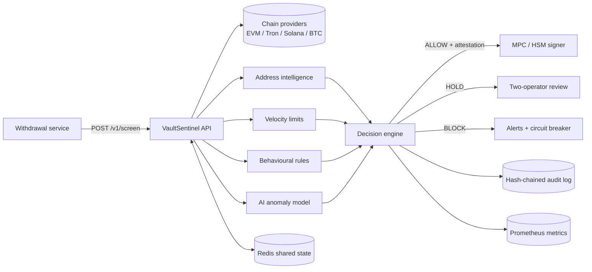
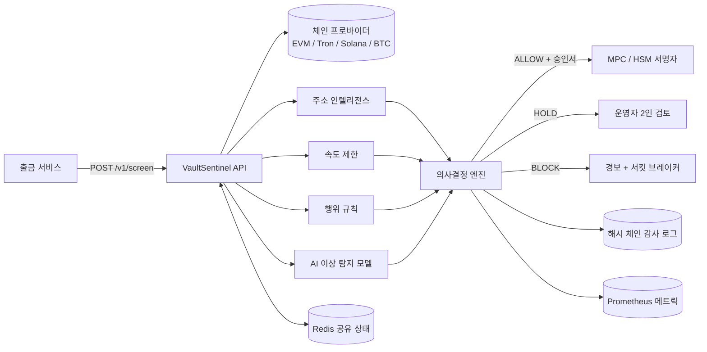

<div align="center">

# VaultSentinel

**AI-powered pre-signing firewall for crypto exchange hot wallets**

**암호화폐 거래소 핫월렛을 위한 AI 기반 서명 전 방화벽**

[](https://github.com/webphilo/vault-sentinel/actions/workflows/ci.yml)
[](https://www.python.org/)
[](https://fastapi.tiangolo.com/)
[](sentinel/detectors/anomaly.py)
[](sentinel/attestation.py)
[](sentinel/providers)
[](deploy/grafana)
[](LICENSE)

[English](#english) | [한국어](#korean)

</div>

---

<a name="english"></a>

## Overview

VaultSentinel is a policy and anomaly-detection service that sits **between the withdrawal pipeline and
the signer** of a crypto exchange. Every outgoing transaction is screened before a signature exists and
receives one of three verdicts:

| Verdict | Meaning | Signer behaviour |
|---|---|---|
| `ALLOW` | Within policy and consistent with learned behaviour | Signs, using the Ed25519 attestation returned with the verdict |
| `HOLD` | Elevated risk | Waits; two distinct operators must approve in the console |
| `BLOCK` | Policy violation or high combined risk | Refuses; alerts fire and the circuit breaker may freeze wallets |

The signer verifies the attestation before signing. A withdrawal that did not pass VaultSentinel has no
valid attestation and cannot be signed, so the control cannot be bypassed by a compromised upstream service.

## Why VaultSentinel

Most exchanges already run some combination of address whitelists, static limits, on-chain monitoring and
manual approval above a threshold. Each of these covers part of the problem; none of them, alone or
combined, stops a fast, automated drain that uses legitimate signing infrastructure.

| Capability | Static whitelist | Backend limits | On-chain monitoring | Manual approval over threshold | MPC / HSM static policy | **VaultSentinel** |
|---|---|---|---|---|---|---|
| Acts before the signature exists | Yes | Yes | No | Yes | Yes | **Yes** |
| Cannot be bypassed by a compromised backend | No | No | n/a | Partial | Yes | **Yes** (signed attestation) |
| Detects fresh and mixer-funded destinations | No | No | After the fact | Depends on reviewer | No | **Yes** |
| Correlates activity across all hot wallets | No | Rarely | After the fact | No | No | **Yes** |
| Learns the exchange's own traffic profile | No | No | Partial | No | No | **Yes** |
| Automatic exchange-wide freeze | No | No | Manual | No | No | **Yes** |
| Bounded worst-case loss | No | Per wallet | No | Above threshold only | Per rule | **Per wallet and exchange-wide** |
| Tamper-evident decision record | No | Varies | n/a | Varies | Varies | **Yes** (hash chain) |
| Behaviour on data or service failure | n/a | Varies | Silent | n/a | Varies | **Fail-closed** |

What this means in practice:

- **Prevention instead of detection.** Monitoring tools report a drain after funds have moved. VaultSentinel
  evaluates the transaction while it is still a request, so a malicious withdrawal is never signed.
- **Correlation across wallets.** Attacks on exchanges usually hit several hot wallets in quick succession.
  Exchange-wide windows, fan-in detection and a global circuit breaker treat the hot wallet fleet as one
  system rather than a set of independent limits.
- **Adaptive, not only static.** Hard rules catch the obvious cases deterministically. The Isolation Forest
  model and the per-wallet online baseline catch withdrawals that pass every threshold but do not look like
  the exchange's normal traffic.
- **Cryptographic enforcement.** Approval is an Ed25519 signature over the exact chain, asset, amount, source
  and destination with a two-minute lifetime. Changing any field, replaying an old approval or skipping the
  screening step produces a transaction the signer will not sign.
- **Bounded loss by construction.** Even an attacker who studies the policy and shapes every transaction
  to pass it is capped by the sliding windows before the breaker and on-call staff take over.
- **Separation of duties.** No single operator can release a held withdrawal or unfreeze a wallet.
- **Explainable decisions.** Every verdict carries the list of signals that produced it, which is what an
  on-call engineer, an auditor or a regulator needs to see.
- **Regulatory alignment.** The treasury monitor tracks the cold storage ratio, including the 80% minimum
  required by South Korea's Virtual Asset User Protection Act.

## Architecture



### Decision model

Each detector emits signals with a score in `[0, 1]`. Signals are combined as independent evidence:

```
risk = 1 - prod(1 - score_i)
```

| Condition | Verdict |
|---|---|
| any signal with `hard_block = true` | `BLOCK` |
| `risk >= 0.85` | `BLOCK` |
| `0.50 <= risk < 0.85` | `HOLD` |
| `risk < 0.50` | `ALLOW` |

Thresholds are configurable in [`config/policy.yaml`](config/policy.yaml). Full design notes:
[docs/ARCHITECTURE.md](docs/ARCHITECTURE.md).

### Detection coverage

| Detector | Signals |
|---|---|
| Address intelligence | Destination age, no on-chain history, mixer funding, denylist, sanctions labels, allowlist bypass |
| Velocity | Per-transaction cap, per-asset caps, assets per transaction, share of wallet balance, sliding windows per wallet and exchange-wide |
| Behaviour | Untrusted initiator, several wallets paying one destination, first payout to a destination, off-hours large withdrawals |
| AI anomaly | Isolation Forest over amount, time of day, weekday, assets per tx, destination age and wallet share; per-wallet online z-score |
| Circuit breaker | Repeated hard blocks on a wallet; hard blocks across several wallets freeze the entire fleet |

Attack patterns and how each is handled: [docs/ATTACK_SCENARIOS.md](docs/ATTACK_SCENARIOS.md).

## Dashboards

### Operator console

Built into the service at `/`. Review queue, circuit breaker control, recent decisions and audit chain status.


### Grafana

A provisioned dashboard ([`deploy/grafana/dashboards/vault-sentinel.json`](deploy/grafana/dashboards/vault-sentinel.json))
is loaded automatically by `docker compose up` and opens as Grafana's home dashboard on `127.0.0.1:3000`.

| Row | Panels |
|---|---|
| Status | Frozen wallets, pending review, blocked (24h), USD blocked (24h), block rate, cold storage ratio |
| Decisions | Decisions per minute by verdict, USD throughput allowed vs blocked, decisions by chain, signals by detector |
| Performance | Screening latency p50 / p95 / p99, requests per second |

Circuit breaker events are drawn as annotations. Prometheus alert rules for breaker trips, block spikes,
large blocked value, review backlog, low cold ratio, latency and availability are in
[`deploy/prometheus/alerts.yml`](deploy/prometheus/alerts.yml). Details: [docs/OBSERVABILITY.md](docs/OBSERVABILITY.md).

## Quick start

```bash
git clone https://github.com/webphilo/vault-sentinel.git
cd vault-sentinel
cp .env.example .env
sentinel keygen >> .env            # Ed25519 attestation key pair
docker compose up -d --build       # VaultSentinel, Redis, Prometheus, Grafana
```

| Service | Address |
|---|---|
| API and operator console | `http://127.0.0.1:8080` |
| OpenAPI documentation | `http://127.0.0.1:8080/docs` |
| Grafana | `http://127.0.0.1:3000` |
| Prometheus | `http://127.0.0.1:9090` |

Local development without Docker:

```bash
python -m venv .venv && source .venv/bin/activate     # Windows: .venv\Scripts\activate
pip install -e ".[redis,dev]"
make train        # synthetic history + model; replace with your own export
make run          # dev mode, no external calls
make simulate     # run the multi-wallet drain simulation
```

## Integration

```python
from sentinel.client import SentinelClient, WithdrawalBlocked

client = SentinelClient(SENTINEL_URL, api_key=SERVICE_KEY, public_key=PINNED_PUBLIC_KEY)

try:
    attestation = client.require_allow(withdrawal, wallet_balance_usd=hot_wallet_balance)
except WithdrawalBlocked as exc:
    reject(withdrawal, reason=str(exc))       # HOLD or BLOCK
else:
    signer.sign(tx, attestation=attestation)  # signer re-verifies before signing
```

Inside the signer:

```python
from sentinel.attestation import verify_attestation

if not verify_attestation(attestation, PINNED_PUBLIC_KEY, withdrawal):
    raise PermissionError("no valid VaultSentinel approval")
```

Step-by-step guide: [docs/INTEGRATION.md](docs/INTEGRATION.md). Reference implementation:
[`examples/signer_integration.py`](examples/signer_integration.py).

## API

| Method | Path | Auth | Purpose |
|---|---|---|---|
| `POST` | `/v1/screen` | service | Screen a withdrawal before signing |
| `GET` | `/v1/public-key` | none | Attestation public key and key id |
| `POST` | `/v1/treasury` | service, operator | Report hot / cold balances, get compliance status |
| `GET` | `/v1/holds` | operator | Withdrawals awaiting review |
| `POST` | `/v1/holds/{id}/approve` | operator | Add an approval |
| `POST` | `/v1/holds/{id}/reject` | operator | Reject a held withdrawal |
| `GET` | `/v1/breaker` | service, operator | Frozen wallets |
| `POST` | `/v1/breaker/trip` | service, operator | Freeze a wallet or `__all__` |
| `POST` | `/v1/breaker/reset` | operator | Vote to unfreeze |
| `POST` | `/v1/freeze-draft` | operator | Stablecoin issuer freeze-request draft |
| `GET` | `/v1/audit`, `/v1/audit/verify` | operator | Audit log and integrity check |
| `GET` | `/v1/stats` | operator | Decision statistics |
| `GET` | `/health`, `/ready`, `/metrics` | none | Liveness, readiness, Prometheus |

## CLI

```text
sentinel serve              Run the API server
sentinel keygen             Generate an Ed25519 attestation key pair
sentinel gen-data FILE      Generate synthetic withdrawal history
sentinel train FILE         Train the anomaly model on a CSV export
sentinel simulate-drain     Run a multi-wallet drain simulation against the policy
sentinel verify-audit       Verify the audit log hash chain
```

## Deployment

| Target | Files |
|---|---|
| Docker Compose | [`docker-compose.yml`](docker-compose.yml) |
| Kubernetes | [`deploy/k8s/`](deploy/k8s) - Deployment (3 replicas, non-root, read-only FS), Service, PDB, NetworkPolicy |
| Prometheus | [`deploy/prometheus/`](deploy/prometheus) |
| Grafana | [`deploy/grafana/`](deploy/grafana) |
| Container image | Published to GHCR on every `v*` tag by [`release.yml`](.github/workflows/release.yml) |

Horizontal scaling requires `SENTINEL_REDIS_URL` so replicas share velocity windows, holds and breaker state.

## Security model

- Fail-closed at every layer: missing data, detector errors and unknown chains raise risk.
- Service and operator credentials are separate; operator identity comes from the key, not from request input.
- Attestations: Ed25519, bound to transaction fields, 120-second lifetime.
- Audit log: SHA-256 hash chain, verifiable with `sentinel verify-audit`.
- Policy changes gated by CODEOWNERS review.

Threat model: [docs/THREAT_MODEL.md](docs/THREAT_MODEL.md). Vulnerability reporting: [SECURITY.md](SECURITY.md).

## Project layout

```
vault-sentinel/
├── sentinel/
│   ├── api.py              REST API and console routes
│   ├── engine.py           decision engine
│   ├── detectors/          address intel, velocity, behaviour, AI anomaly
│   ├── providers/          EVM, Tron, Solana, Bitcoin data sources
│   ├── alerts/             Telegram, Slack, webhooks, freeze drafts
│   ├── attestation.py      Ed25519 approvals
│   ├── breaker.py          circuit breaker
│   ├── holds.py            review queue
│   ├── audit.py            hash-chained audit log
│   ├── state.py            in-memory and Redis state
│   ├── treasury.py         cold storage ratio
│   ├── client.py           Python SDK for signers
│   └── dashboard/          operator console
├── config/                 policy and address lists
├── deploy/                 Kubernetes, Prometheus, Grafana
├── docs/                   architecture, integration, scenarios, observability, threat model
├── examples/               signer integration
└── tests/
```

## Roadmap

- [x] Rule-based, behavioural and ML detection
- [x] Signed attestations, circuit breaker, two-operator review, hash-chained audit
- [x] EVM, Tron, Solana and Bitcoin providers
- [x] Prometheus metrics, alert rules, Grafana dashboard
- [ ] Chainalysis, TRM and Arkham label feeds
- [ ] Graph clustering of attacker address networks
- [ ] Native co-signer plug-ins for common MPC stacks
- [ ] XRP, TON and Cosmos providers

## Limitations

VaultSentinel protects the signing path. If private key material is exfiltrated and used outside the
exchange's infrastructure, no pre-signing control can observe it; deploy VaultSentinel as a mandatory
MPC or multisig co-signer. Default thresholds are starting points and must be tuned to the exchange's
volumes. An independent security review is recommended before production use.

---

<a name="korean"></a>

## 개요

VaultSentinel은 암호화폐 거래소의 **출금 파이프라인과 서명 시스템 사이**에 위치하는 정책 및 이상 탐지
서비스입니다. 모든 출금 트랜잭션은 서명이 생성되기 전에 검사되며, 다음 세 가지 판정 중 하나를 받습니다.

| 판정 | 의미 | 서명자 동작 |
|---|---|---|
| `ALLOW` | 정책 범위 내이며 학습된 패턴과 일치 | 판정과 함께 반환된 Ed25519 승인서로 서명 |
| `HOLD` | 위험도 상승 | 대기, 콘솔에서 서로 다른 운영자 2인의 승인 필요 |
| `BLOCK` | 정책 위반 또는 높은 종합 위험도 | 거부, 경보 발송 및 서킷 브레이커 작동 가능 |

서명자는 서명 전에 승인서를 검증합니다. VaultSentinel을 거치지 않은 출금에는 유효한 승인서가 없으므로
서명될 수 없으며, 상위 서비스가 침해되더라도 이 통제를 우회할 수 없습니다.

## 왜 VaultSentinel인가

대부분의 거래소는 이미 주소 화이트리스트, 고정 한도, 온체인 모니터링, 일정 금액 이상 수동 승인 등을
조합하여 운영합니다. 각각은 문제의 일부만 다루며, 정상적인 서명 인프라를 이용한 빠르고 자동화된
자산 유출은 이들만으로 막을 수 없습니다.

| 기능 | 고정 화이트리스트 | 백엔드 한도 | 온체인 모니터링 | 고액 수동 승인 | MPC / HSM 고정 정책 | **VaultSentinel** |
|---|---|---|---|---|---|---|
| 서명 생성 전 차단 | 예 | 예 | 아니오 | 예 | 예 | **예** |
| 침해된 백엔드로 우회 불가 | 아니오 | 아니오 | 해당 없음 | 부분적 | 예 | **예** (서명된 승인서) |
| 신규 주소 및 믹서 자금 주소 탐지 | 아니오 | 아니오 | 사후 | 검토자에 따라 다름 | 아니오 | **예** |
| 전체 핫월렛 간 활동 상관 분석 | 아니오 | 드묾 | 사후 | 아니오 | 아니오 | **예** |
| 거래소 고유 트래픽 패턴 학습 | 아니오 | 아니오 | 부분적 | 아니오 | 아니오 | **예** |
| 거래소 전체 자동 동결 | 아니오 | 아니오 | 수동 | 아니오 | 아니오 | **예** |
| 최대 손실 한정 | 아니오 | 지갑 단위 | 아니오 | 임계값 이상만 | 규칙 단위 | **지갑 단위 및 거래소 전체** |
| 위변조 방지 결정 기록 | 아니오 | 상이 | 해당 없음 | 상이 | 상이 | **예** (해시 체인) |
| 데이터·서비스 장애 시 동작 | 해당 없음 | 상이 | 무응답 | 해당 없음 | 상이 | **Fail-closed** |

실무적 의미:

- **사후 탐지가 아닌 사전 차단.** 모니터링 도구는 자금이 이동한 후에 알립니다. VaultSentinel은 트랜잭션이
  아직 요청 단계일 때 평가하므로 악성 출금은 서명되지 않습니다.
- **지갑 간 상관 분석.** 거래소 공격은 보통 여러 핫월렛을 연달아 노립니다. 거래소 전체 윈도우, 동일 주소
  집중(fan-in) 탐지, 전역 서킷 브레이커는 핫월렛 전체를 하나의 시스템으로 다룹니다.
- **고정 규칙과 적응형 모델의 결합.** 명확한 사례는 강제 규칙이 결정론적으로 차단하고, 모든 임계값을
  통과하지만 거래소의 정상 트래픽과 다른 출금은 Isolation Forest 모델과 지갑별 실시간 기준선이 탐지합니다.
- **암호학적 강제.** 승인은 체인, 자산, 금액, 출발지, 목적지에 대한 Ed25519 서명이며 유효기간은 2분입니다.
  필드를 변경하거나, 이전 승인을 재사용하거나, 검사 단계를 건너뛴 트랜잭션은 서명되지 않습니다.
- **구조적으로 한정된 손실.** 정책을 분석하여 모든 트랜잭션을 통과하도록 조작한 공격자도 슬라이딩
  윈도우에 의해 제한되며, 이후 서킷 브레이커와 당직자가 대응합니다.
- **직무 분리.** 단일 운영자는 보류 출금을 승인하거나 지갑 동결을 해제할 수 없습니다.
- **설명 가능한 결정.** 모든 판정에는 근거가 된 신호 목록이 포함되어 당직자, 감사인, 규제기관이 확인할 수 있습니다.
- **규제 대응.** 자산 보관 모니터가 가상자산이용자보호법의 콜드월렛 80% 이상 보관 의무를 포함한 비율을 추적합니다.

## 아키텍처



### 의사결정 모델

각 탐지기는 `[0, 1]` 범위의 점수를 가진 신호를 생성하며, 신호는 독립적인 증거로 결합됩니다.

```
risk = 1 - prod(1 - score_i)
```

| 조건 | 판정 |
|---|---|
| `hard_block = true`인 신호가 하나라도 존재 | `BLOCK` |
| `risk >= 0.85` | `BLOCK` |
| `0.50 <= risk < 0.85` | `HOLD` |
| `risk < 0.50` | `ALLOW` |

임계값은 [`config/policy.yaml`](config/policy.yaml)에서 설정합니다. 상세 설계: [docs/ARCHITECTURE.md](docs/ARCHITECTURE.md).

### 탐지 범위

| 탐지기 | 신호 |
|---|---|
| 주소 인텔리전스 | 목적지 주소 생성 시점, 온체인 이력 부재, 믹서 자금 유입, 차단 목록, 제재 라벨, 허용 목록 |
| 속도 제한 | 건당 한도, 자산별 한도, 트랜잭션당 자산 수, 지갑 잔액 대비 비율, 지갑별·거래소 전체 슬라이딩 윈도우 |
| 행위 규칙 | 미등록 요청자, 여러 지갑에서 동일 주소로 송금, 신규 목적지 최초 송금, 비근무 시간 고액 출금 |
| AI 이상 탐지 | 금액, 시간대, 요일, 트랜잭션당 자산 수, 목적지 생성 시점, 지갑 비율 기반 Isolation Forest; 지갑별 실시간 z-score |
| 서킷 브레이커 | 단일 지갑 반복 차단 시 해당 지갑 동결, 여러 지갑 차단 시 전체 동결 |

공격 유형별 대응: [docs/ATTACK_SCENARIOS.md](docs/ATTACK_SCENARIOS.md).

## 대시보드

### 운영자 콘솔

서비스의 `/` 경로에 내장되어 있습니다. 검토 대기열, 서킷 브레이커 제어, 최근 판정, 감사 로그 무결성 상태를 제공합니다.


### Grafana

사전 구성된 대시보드([`deploy/grafana/dashboards/vault-sentinel.json`](deploy/grafana/dashboards/vault-sentinel.json))가
`docker compose up` 실행 시 자동으로 로드되며 `127.0.0.1:3000`에서 Grafana 홈 대시보드로 열립니다.

| 행 | 패널 |
|---|---|
| 상태 | 동결된 지갑, 검토 대기, 24시간 차단 건수, 24시간 차단 금액, 차단율, 콜드월렛 비율 |
| 판정 | 판정별 분당 건수, 허용·차단 금액 처리량, 체인별 판정, 탐지기별 신호 |
| 성능 | 검사 지연시간 p50 / p95 / p99, 초당 요청 수 |

서킷 브레이커 이벤트는 주석으로 표시됩니다. 브레이커 작동, 차단 급증, 고액 차단, 검토 적체, 콜드월렛 비율
저하, 지연, 가용성에 대한 Prometheus 경보 규칙은 [`deploy/prometheus/alerts.yml`](deploy/prometheus/alerts.yml)에
있습니다. 상세: [docs/OBSERVABILITY.md](docs/OBSERVABILITY.md).

## 빠른 시작

```bash
git clone https://github.com/webphilo/vault-sentinel.git
cd vault-sentinel
cp .env.example .env
sentinel keygen >> .env            # Ed25519 승인서 키 쌍 생성
docker compose up -d --build       # VaultSentinel, Redis, Prometheus, Grafana
```

| 서비스 | 주소 |
|---|---|
| API 및 운영자 콘솔 | `http://127.0.0.1:8080` |
| OpenAPI 문서 | `http://127.0.0.1:8080/docs` |
| Grafana | `http://127.0.0.1:3000` |
| Prometheus | `http://127.0.0.1:9090` |

Docker 없이 로컬 개발:

```bash
python -m venv .venv && source .venv/bin/activate     # Windows: .venv\Scripts\activate
pip install -e ".[redis,dev]"
make train        # 합성 이력 생성 및 모델 학습, 실제 데이터로 교체 권장
make run          # 개발 모드, 외부 호출 없음
make simulate     # 다중 지갑 유출 시뮬레이션 실행
```

## 연동

```python
from sentinel.client import SentinelClient, WithdrawalBlocked

client = SentinelClient(SENTINEL_URL, api_key=SERVICE_KEY, public_key=PINNED_PUBLIC_KEY)

try:
    attestation = client.require_allow(withdrawal, wallet_balance_usd=hot_wallet_balance)
except WithdrawalBlocked as exc:
    reject(withdrawal, reason=str(exc))       # HOLD 또는 BLOCK
else:
    signer.sign(tx, attestation=attestation)  # 서명자가 서명 전 재검증
```

단계별 가이드: [docs/INTEGRATION.md](docs/INTEGRATION.md). 참조 구현:
[`examples/signer_integration.py`](examples/signer_integration.py).

## API

| 메서드 | 경로 | 인증 | 용도 |
|---|---|---|---|
| `POST` | `/v1/screen` | 서비스 | 서명 전 출금 검사 |
| `GET` | `/v1/public-key` | 없음 | 승인서 공개키 및 키 ID |
| `POST` | `/v1/treasury` | 서비스, 운영자 | 핫/콜드 잔액 보고 및 규정 준수 상태 |
| `GET` | `/v1/holds` | 운영자 | 검토 대기 출금 |
| `POST` | `/v1/holds/{id}/approve` | 운영자 | 승인 추가 |
| `POST` | `/v1/holds/{id}/reject` | 운영자 | 보류 출금 거절 |
| `GET` | `/v1/breaker` | 서비스, 운영자 | 동결된 지갑 |
| `POST` | `/v1/breaker/trip` | 서비스, 운영자 | 지갑 또는 `__all__` 동결 |
| `POST` | `/v1/breaker/reset` | 운영자 | 동결 해제 투표 |
| `POST` | `/v1/freeze-draft` | 운영자 | 스테이블코인 발행사 동결 요청서 초안 |
| `GET` | `/v1/audit`, `/v1/audit/verify` | 운영자 | 감사 로그 및 무결성 검증 |
| `GET` | `/v1/stats` | 운영자 | 판정 통계 |
| `GET` | `/health`, `/ready`, `/metrics` | 없음 | 헬스 체크, 준비 상태, Prometheus |

## CLI

```text
sentinel serve              API 서버 실행
sentinel keygen             Ed25519 승인서 키 쌍 생성
sentinel gen-data FILE      합성 출금 이력 생성
sentinel train FILE         CSV 데이터로 이상 탐지 모델 학습
sentinel simulate-drain     정책에 대한 다중 지갑 유출 시뮬레이션
sentinel verify-audit       감사 로그 해시 체인 검증
```

## 배포

| 대상 | 파일 |
|---|---|
| Docker Compose | [`docker-compose.yml`](docker-compose.yml) |
| Kubernetes | [`deploy/k8s/`](deploy/k8s) - Deployment(레플리카 3개, non-root, 읽기 전용 FS), Service, PDB, NetworkPolicy |
| Prometheus | [`deploy/prometheus/`](deploy/prometheus) |
| Grafana | [`deploy/grafana/`](deploy/grafana) |
| 컨테이너 이미지 | `v*` 태그마다 [`release.yml`](.github/workflows/release.yml)이 GHCR에 게시 |

수평 확장 시 레플리카 간 속도 윈도우, 보류 대기열, 브레이커 상태를 공유하기 위해 `SENTINEL_REDIS_URL`이 필요합니다.

## 보안 모델

- 모든 계층에서 fail-closed: 데이터 누락, 탐지기 오류, 미지원 체인은 위험도를 높입니다.
- 서비스와 운영자 자격 증명은 분리되며, 운영자 신원은 요청 입력이 아닌 키에서 결정됩니다.
- 승인서: Ed25519, 트랜잭션 필드에 바인딩, 유효기간 120초.
- 감사 로그: SHA-256 해시 체인, `sentinel verify-audit`로 검증.
- 정책 변경은 CODEOWNERS 검토를 거칩니다.

위협 모델: [docs/THREAT_MODEL.md](docs/THREAT_MODEL.md). 취약점 신고: [SECURITY.md](SECURITY.md).

## 로드맵

- [x] 규칙, 행위, 머신러닝 기반 탐지
- [x] 서명된 승인서, 서킷 브레이커, 운영자 2인 검토, 해시 체인 감사 로그
- [x] EVM, Tron, Solana, Bitcoin 프로바이더
- [x] Prometheus 메트릭, 경보 규칙, Grafana 대시보드
- [ ] Chainalysis, TRM, Arkham 라벨 연동
- [ ] 공격자 주소 네트워크 그래프 클러스터링
- [ ] 주요 MPC 스택용 공동 서명 플러그인
- [ ] XRP, TON, Cosmos 프로바이더

## 한계

VaultSentinel은 서명 경로를 보호합니다. 개인키가 유출되어 거래소 인프라 외부에서 사용되면 서명 전 통제로는
탐지할 수 없으므로, VaultSentinel을 MPC 또는 멀티시그의 필수 공동 서명자로 배포해야 합니다. 기본 임계값은
출발점이며 거래소 규모에 맞게 조정해야 합니다. 운영 환경 도입 전 독립적인 보안 검토를 권장합니다.

---

<div align="center">

[Security](SECURITY.md) | [Contributing](CONTRIBUTING.md) | [Code of Conduct](CODE_OF_CONDUCT.md) | [Changelog](CHANGELOG.md) | [MIT License](LICENSE)

</div>
