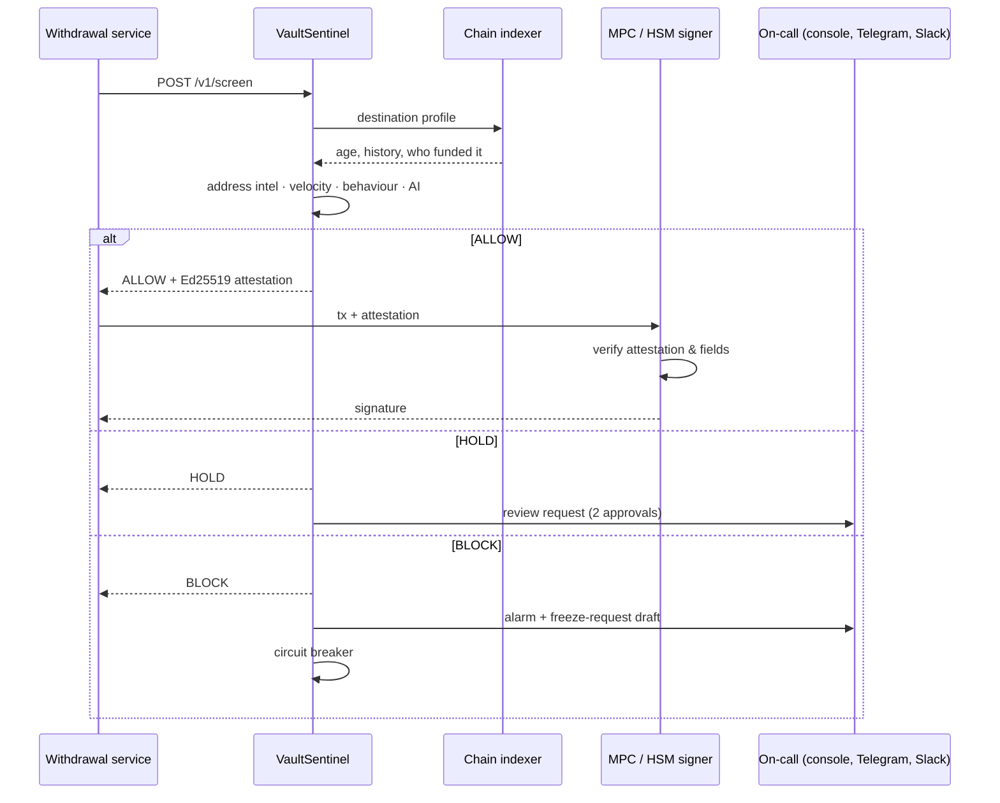

# Architecture



## Components

| Module | Responsibility |
|---|---|
| `engine.py` | Runs detectors, combines signals, issues decisions |
| `detectors/address_intel.py` | Address age, mixer funding, deny / allow lists |
| `detectors/velocity.py` | Per-tx cap, per-asset caps, share-of-wallet, sliding windows per wallet and exchange-wide |
| `detectors/behavior.py` | Unknown initiators, fan-in to one address, first payouts, off-hours |
| `detectors/anomaly.py` | Isolation Forest + per-wallet online baseline |
| `breaker.py` | Wallet / exchange-wide freeze, four-eyes unfreeze |
| `holds.py` | Manual review queue |
| `attestation.py` | Ed25519 approvals bound to the exact transaction, 2-minute TTL |
| `audit.py` | SHA-256 hash-chained SQLite log |
| `state.py` | In-memory or Redis state shared by replicas |
| `providers/` | EVM, Tron, Solana, Bitcoin data sources with TTL cache |
| `alerts/` | Telegram, Slack, signed webhooks, stablecoin freeze drafts |
| `treasury.py` | Hot / cold ratio monitor |
| `api.py` | FastAPI service + operator console |

## Risk model

Signals are treated as independent; combined risk is the probability that at least one is right:

```
risk = 1 − Π (1 − scoreᵢ)
```

Any signal with `hard_block = true` forces BLOCK regardless of the total.

| Combined risk | Decision |
|---|---|
| `< hold_threshold` (0.50) | ALLOW |
| `≥ hold_threshold` | HOLD |
| `≥ block_threshold` (0.85) or any hard rule | BLOCK |

## Fail-closed by design

- Indexer unavailable → risk +0.55 → HOLD.
- Detector crashes → risk +0.60.
- Unknown chain → no provider → HOLD.
- Sentinel unreachable → the signer has no attestation → no signature.
