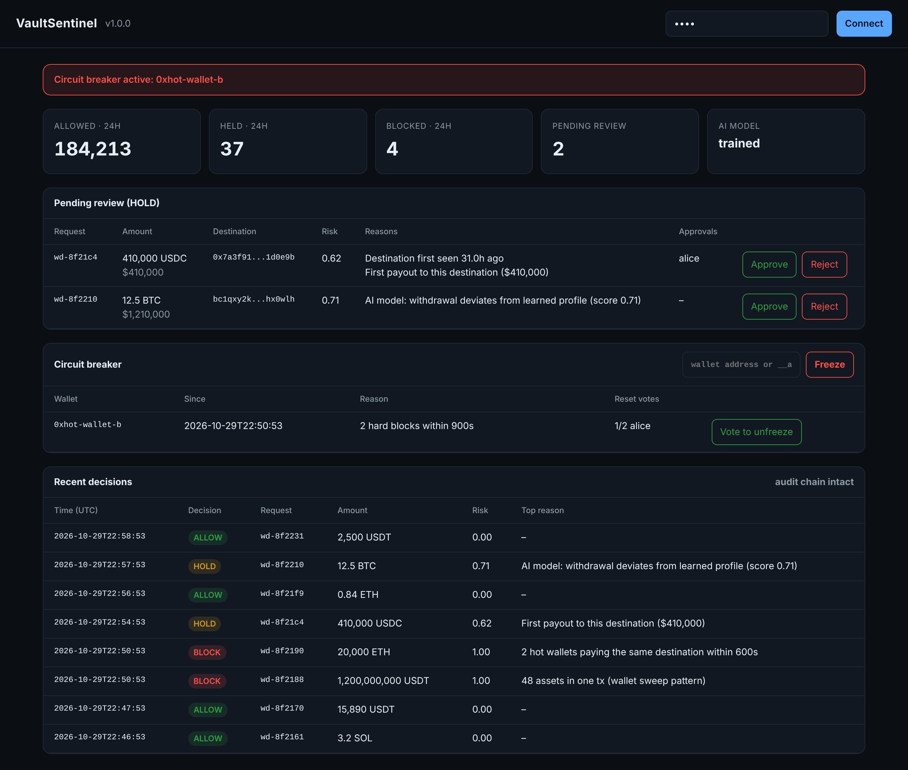

# Observability

VaultSentinel exposes Prometheus metrics at `/metrics`, ships a provisioned Grafana dashboard and a set of
Prometheus alert rules, and includes a built-in operator console.

## Operator console

Served at `/`. Requires an operator API key. Refreshes every 5 seconds.

| Section | Purpose |
|---|---|
| Summary tiles | ALLOW / HOLD / BLOCK counts for the last 24 h, review queue size, AI model status |
| Pending review | Held withdrawals with risk score, reasons and collected approvals; approve or reject |
| Circuit breaker | Frozen wallets, reason, reset votes; manual freeze of any wallet or `__all__` |
| Recent decisions | Last 50 decisions with top reason and audit chain integrity status |

## Grafana dashboard

`deploy/grafana/dashboards/vault-sentinel.json` is provisioned automatically by `docker compose up`
(Grafana on `127.0.0.1:3000`, default home dashboard).

| Row | Panel | Query basis |
|---|---|---|
| Status | Frozen wallets | `sentinel_breaker_tripped_wallets` |
| Status | Pending review | `sentinel_holds_pending` |
| Status | Blocked (24h), USD blocked (24h) | `sentinel_decisions_total`, `sentinel_usd_blocked_total` |
| Status | Block rate (1h) | blocked / all decisions |
| Status | Cold storage ratio | `sentinel_cold_storage_ratio` |
| Decisions | Decisions per minute (stacked by decision) | `sentinel_decisions_total` |
| Decisions | USD throughput, allowed vs blocked | `sentinel_usd_allowed_total`, `sentinel_usd_blocked_total` |
| Decisions | Decisions by chain | `sentinel_decisions_total{chain}` |
| Decisions | Risk signals by detector, hard rules | `sentinel_signals_total` |
| Performance | Screening latency p50 / p95 / p99 | `sentinel_screen_latency_seconds` |
| Performance | Requests per second | `sentinel_screen_latency_seconds_count` |

Circuit breaker state changes are drawn as annotations on every time series panel.

## Metrics reference

| Metric | Type | Labels |
|---|---|---|
| `sentinel_decisions_total` | counter | `decision`, `chain` |
| `sentinel_signals_total` | counter | `detector`, `hard` |
| `sentinel_screen_latency_seconds` | histogram | — |
| `sentinel_usd_blocked_total` | counter | `chain` |
| `sentinel_usd_allowed_total` | counter | `chain` |
| `sentinel_breaker_tripped_wallets` | gauge | — |
| `sentinel_holds_pending` | gauge | — |
| `sentinel_cold_storage_ratio` | gauge | — |

## Alert rules

`deploy/prometheus/alerts.yml`:

| Alert | Condition | Severity |
|---|---|---|
| `SentinelCircuitBreakerTripped` | any wallet frozen | critical |
| `SentinelBlockSpike` | more than 3 blocks in 5 minutes | critical |
| `SentinelLargeValueBlocked` | more than 1M USD blocked in 10 minutes | critical |
| `SentinelDown` | scrape target down for 1 minute | critical |
| `SentinelHoldsPiling` | more than 20 held withdrawals for 10 minutes | warning |
| `SentinelColdRatioLow` | cold storage ratio below 80% for 5 minutes | warning |
| `SentinelSlow` | p99 latency above 1 s for 5 minutes | warning |

## Logs

Structured JSON on stdout (`ts`, `level`, `logger`, `msg`), suitable for Loki, Elasticsearch or any log
pipeline. Every non-ALLOW verdict is also logged at WARNING level with its full reasoning.
